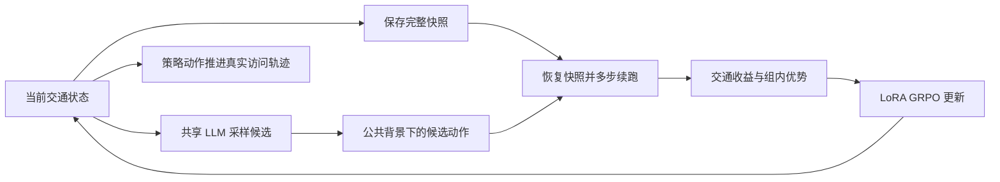

# 配对反事实 GRPO：共享 LLM 的多路口交通信号控制方法

更新：2026-11-17。本文对照当前代码介绍第一部分毕业设计的方法。

**暂定名称：Paired Counterfactual GRPO for Traffic Signal Control，简称 Paired-CF-GRPO。**

当前定位是成熟机制的任务化融合：将多步仿真分支评估、条件动作比较和 GRPO 结合起来，研究多路口环境中的决策级信用分配。本文不声称提出全新反事实原理，也不包含尚未完成的 GPU 实验结论。

## 1. 方法概述

我们使用一个共享的 Qwen3.5-0.8B 作为交通控制策略，在每个控制时刻为多个路口分别生成信号相位。训练时，从当前交通状态保存完整仿真快照，针对某个目标路口采样多个候选回复。在比较这些候选时，保持其他路口的当前动作一致，让每个候选在可比的网络背景下运行；之后再由冻结的当前策略进行多步续跑，以累计排队成本评价动作后果。

将候选收益转为组内优势后，使用 GRPO 更新 LLM 的 LoRA 参数。所有分支结束后恢复真实访问状态，通过预先采样的策略动作推进训练轨迹，再继续采集。

核心问题是：

> 同一个路口的候选动作，在不同联合决策背景下可能得到不同的网络收益。能否通过配对背景构造更可比的训练组，从而改善有限预算下的信用估计和策略学习？

本方法的主要改动发生在**训练样本组的构造与环境评分过程**。优势标准化和 clipped policy update 使用常见做法；不额外叠加 LLM judge 或思维链 span 奖励。

## 2. 任务定义

### 2.1 多路口、多步协作控制

路网为图 \(\mathcal G=(\mathcal V,\mathcal E)\)，其中 \(N=|\mathcal V|\) 个受控路口为智能体。完整交通状态为 \(s_t\)，路口 \(i\) 的观测为 \(o_{i,t}\)。

所有路口共享同一个 LLM 参数 \(\theta\)，但分别根据自己的观测调用策略：

\[
y_{i,t}\sim\pi_\theta(\cdot\mid x_{i,t}),
\qquad
a_{i,t}=f(y_{i,t}),
\]

其中 \(x_{i,t}\) 是由观测构造的文本 prompt，\(y_{i,t}\) 是生成的完整回复，\(f\) 解析回复中的最终信号相位。

联合动作 \(\mathbf a_t=(a_{1,t},\ldots,a_{N,t})\) 作用于 CityFlow，产生后续交通状态。任务是环境中的多步控制；单次 LLM 回复只决定当前控制间隔的相位。

**一个模型不等于一个路口或一个决策步。** 这里是参数共享的多智能体控制，没有引入快慢两个决策角色。

### 2.2 当前观测

当前实现输入以下信息：

- 路口 ID、仿真时间、当前相位与控制间隔；
- 各候选相位对应进口的排队车辆与行驶车辆数量；
- 对应下游接收车道的排队与车辆数量；
- 相邻受控路口的进口总队列。

prompt 不包含候选回报、未来交通状态、最优相位标签或反事实评分。当前接口没有显式历史记忆或额外预测工具。

### 2.3 动作与输出

| 信号 | 含义 | 算法动作编号 | CityFlow 绿灯相位编号 |
|---|---|---:|---:|
| ETWT | 东西向直行 | 0 | 1 |
| NTST | 南北向直行 | 1 | 2 |
| ELWL | 东西向左转 | 2 | 3 |
| NLSL | 南北向左转 | 3 | 4 |

CityFlow phase 0 是路网定义的清空相位。右转按路网定义执行。

模型输出示例：

```text
东西向排队需求更高，且下游仍可接收。
<signal>ETWT</signal>
```

策略输入/输出使用文本，训练的动作概率来自生成 token 的概率。交通环境只接收解析后的离散相位。

默认每 30s 决策一次，切换时 5s phase 0 包含在该 30s 间隔中，保持相位不插入清空。模型不直接输出绿灯秒数；连续选择同一相位可以延长放行。

## 3. 为什么需要配对反事实组

设目标路口为 \(i\)，候选相位为 \(a\) 和 \(a'\)。若两个候选分别与不同的其他路口当前动作组合，网络回报差异可能同时包含：

1. 目标路口相位的影响；
2. 其他路口当前动作的影响；
3. 后续策略与环境转移的变化。

有限样本下，这些差异可能使动作优劣排序不稳定。独立联合采样并不必然有系统偏差，不能把所有误差都称为“错误因果归因”。

配对比较固定同一个初始状态和同一组其他路口当前动作，只改变目标路口动作，减少一个可控制的背景差异。它不会消除未来全部随机性，也不保证所有场景的估计方差都下降。

例如，比较目标路口 ETWT 与 NTST 时，两条分支的下游路口本次都选择相同相位；否则，ETWT 可能恰好遇到下游疏解、NTST 恰好遇到下游封堵，使单次结果难以解释。

这里不删除某个路口，也不强制关闭其信号。反事实操作是：**替换目标路口的一次合法相位选择。**

## 4. 配对反事实多步评估

### 4.1 冻结行为策略并保存完整状态

每个采集窗口开始后，策略参数保持为 \(\theta_{old}\)，直到本窗口的采集和评分全部结束。所谓冻结是暂不更新参数，不要求在 GPU 上另存一整份策略副本。

在状态 \(s_t\) 处保存快照 \(\xi_t\)。快照不仅包括 CityFlow 引擎，还包括 Python 环境中的相位计时、等待记录、车辆到离记录、相关随机状态与控制器状态，避免恢复后环境统计与交通动力学不同步。

### 4.2 选择目标路口并采样候选

每个访问状态选择少量目标路口，默认 2 个，按路口顺序轮换覆盖路网。并不是在每个时刻同时对所有路口逐一展开干预。

对目标路口 \(i\)，从完全相同的 prompt 采样 \(G\) 个回复：

\[
\mathcal Y_{i,t}=\{y_{i,t}^{(1)},\ldots,y_{i,t}^{(G)}\},
\qquad y_{i,t}^{(k)}\sim\pi_{old}(\cdot\mid x_{i,t}).
\]

默认 \(G=4\)，训练采用 temperature=1、top_p=1、top_k=0。四个回复不一定覆盖四种相位，也可能选择重复相位。

### 4.3 采样公共动作背景

从冻结旧策略采样一个联合动作，然后用目标候选替换目标路口的动作。等价地，记其余路口的当前动作背景为：

\[
b_{-i,t}^{(m)}\sim\pi_{old,-i}(\cdot\mid s_t),
\qquad m=1,\ldots,M.
\]

式中的 \(s_t\) 用于描述联合状态条件；每个路口实际只读取自己的规定观测。默认 \(M=1\)。

同一个背景 \(m\) 下，所有目标候选共享 \(b_{-i,t}^{(m)}\)。第 \((k,m)\) 条分支的第一步联合动作为：

\[
\mathbf a_t^{(i,k,m)}
=\big(a_{i,t}^{(k)},b_{-i,t}^{(m)}\big).
\]

### 4.4 真实仿真续跑

对每条分支：

1. 恢复同一个完整快照 \(\xi_t\)；
2. 执行候选相位与公共背景组成的第一步联合动作；
3. 后续每一步，所有路口根据分支自身的新状态，由 \(\pi_{old}\) 重新生成动作；
4. 记录 \(H\) 步内的交通成本。

**只配对其他路口的当前动作，不固定其全部未来动作。** 目标动作改变后，未来交通状态和其他路口的响应允许随之改变，这是多步后果的一部分。不同分支的后续 LLM 采样也没有强制使用相同随机动作序列。

默认 \(H=3\)，含第一步，通常覆盖 90s。靠近 episode 终点时，实际长度为剩余完整控制步与 H 的较小值。

### 4.5 连续交通收益

令 \(Q_i(\tau)\) 为路口 \(i\) 在物理秒 \(\tau\) 的进口排队车辆总数，控制间隔为 \(\Delta=30\) 秒。默认每个控制步的交通奖励是：

\[
r_t=-\frac{1}{\Delta}\sum_{u=1}^{\Delta}
\sum_{i=1}^{N} Q_i(t\Delta+u).
\]

其含义是该控制间隔内全网进口队列的逐秒平均值取负。不是只评价间隔结束或 episode 结束时的拥堵。

候选分支回报为：

\[
Z_{i,t,k}^{(m)}
=\sum_{h=0}^{H_t-1}\gamma^h r_{t+h}^{(i,k,m)},
\qquad \gamma=0.99.
\]

这里折扣单位是控制步，不是生成 token 或物理秒。多个背景时取平均：

\[
\bar Z_{i,t,k}=\frac{1}{M}\sum_{m=1}^{M}Z_{i,t,k}^{(m)}.
\]

奖励是连续的交通反馈，不依赖“是否等于 Best_Signal”的最终 0/1 标签。但它仍是有限 horizon 的排队代理目标，并不直接等于最终 ATT。

## 5. 相位评分与组内信用

### 5.1 同一相位共享交通分数

同一 prompt 下，不同文字回复可能选择同一个相位。当前实现先对这些回复对应的分支回报求平均：

\[
\mathcal C_{i,t}(a)=\{k:f(y_{i,t}^{(k)})=a\},
\]

\[
\hat Q_{i,t}(a)=\frac{1}{|\mathcal C_{i,t}(a)|}
\sum_{k\in\mathcal C_{i,t}(a)}\bar Z_{i,t,k}.
\]

合法回复的分数为 \(q_{i,t,k}=\hat Q_{i,t}(a_{i,t}^{(k)})\)。

这样处理是因为环境执行的是相位；同一物理相位不应仅因文字不同获得不同交通评价。当前每个回复仍执行相同数量的分支续跑，包括重复相位，之后才平均；不是只为不同相位各跑一次。

### 5.2 非法输出

若回复缺少唯一合法 `<signal>` 标签，则执行保持当前合法相位的回退。它的分数使用该回退分支的交通回报，再减去格式惩罚：

\[
q_{invalid}=\bar Z_{fallback}-\lambda_{invalid},
\qquad \lambda_{invalid}=1000.
\]

它不是无效回复直接得 0 分。由于有效交通收益通常为负，简单给无效回复 0 分可能反而鼓励错误格式。当前惩罚是固定工程参数，不代表已验证的最优设置。

### 5.3 组相对优势

对同一目标路口、同一访问状态的 G 个候选分数，计算：

\[
\hat A_{i,t,k}
=\frac{q_{i,t,k}-\mu_{i,t}}{\sigma_{i,t}+\varepsilon},
\quad
\mu_{i,t}=\frac1G\sum_{j=1}^{G}q_{i,t,j},
\]

\[
\sigma_{i,t}
=\sqrt{\frac1G\sum_{j=1}^{G}(q_{i,t,j}-\mu_{i,t})^2},
\qquad \varepsilon=10^{-6}.
\]

使用总体标准差。所有分数相同时，优势为零，不人为制造学习信号。

这里的反事实信用体现在**组内比较条件的对齐**，没有额外先减一个公共标量再宣称新算法；也没有把局部优势与另一个全局轨迹优势加权求和。

分配单位是路口—时刻—回复对应的动作。当前方法不是对整段网络收益作严格守恒分解，也不保证所有路口优势之和等于轨迹总收益。

## 6. LLM 的 GRPO 更新

### 6.1 保留实际评分的 token

每个样本保存 prompt、生成 token、回复文本、解析相位、分支回报与优势。模型更新使用的正是这批已被环境评分的 token，不在更新阶段重新生成另一批回复。

在任何 optimizer 更新之前，计算并保存这些 token 在 \(\pi_{old}\) 下的对数概率。参考策略 \(\pi_{ref}\) 是冻结的初始 Qwen 基座，通过暂时禁用 LoRA 计算，不额外加载一个交通 critic。

### 6.2 Token 级 clipped surrogate

令回复 \(y_k\) 长度为 \(L_k\)，第 \(\ell\) 个生成 token 的概率比为：

\[
\rho_{k,\ell}(\theta)
=\frac{\pi_\theta(y_{k,\ell}\mid x_k,y_{k,<\ell})}
{\pi_{old}(y_{k,\ell}\mid x_k,y_{k,<\ell})}.
\]

最小化的损失为：

\[
\mathcal L(\theta)
=\frac1{|\mathcal D|}\sum_{k\in\mathcal D}\frac1{L_k}
\sum_{\ell=1}^{L_k}
\left[
-\min\left(
\rho_{k,\ell}\hat A_k,
\operatorname{clip}(\rho_{k,\ell},1-\epsilon,1+\epsilon)\hat A_k
\right)
+\beta\,\widehat{KL}_{k,\ell}
\right].
\]

当前 \(\epsilon=0.2\)、\(\beta=0.02\)。KL 项使用：

\[
d_{k,\ell}=\log\pi_{ref}(y_{k,\ell}\mid\cdot)
-\log\pi_\theta(y_{k,\ell}\mid\cdot),
\qquad
\widehat{KL}_{k,\ell}=e^{d_{k,\ell}}-d_{k,\ell}-1.
\]

这是 sampled-token 的 KL 正则估计，不是在每个位置枚举整个词表的精确 KL；更新中的样本由旧策略采集，不据此声称任何无偏或收敛保证。

每个回复先对自己的 token 损失取均值，再在更新样本间平均。只训练生成部分，prompt token 不作为输出监督。完整回复的各个 token 共享同一个 \(\hat A_k\)，包括简短说明和相位标签。

因此，当前策略能够通过 RL 调整输出，但**不能把结果解释为已经识别了理由中哪些词或推理 span 的交通因果贡献**。

### 6.3 参数与软件实现

策略使用 Qwen3.5-0.8B 的文本骨干，BF16，关闭额外 thinking 模式。LoRA rank=8、alpha=16、dropout=0、all-linear，优化器 AdamW，学习率 \(10^{-6}\)。

框架为 PyTorch + Transformers + PEFT，GRPO 更新显式实现于 `tsc_experiments/trainer.py`。本入口不调用 TRL/verl 训练器，没有 value head、GAE、额外奖励模型或 LLM judge。

## 7. 在线训练与部署分离

### 7.1 一个采集窗口如何运行

```text
冻结当前策略 π_old
  对窗口中的每个真实访问状态：
    采样一个用于推进训练轨迹的联合动作 a_visit
    保存完整状态快照
    轮换选取目标路口
    对每个目标路口：
      从同一 prompt 采样 G 个回复
      对每个背景 m：
        采样公共其他路口当前动作
        对每个候选 k：
          恢复快照
          执行目标候选 + 公共背景
          冻结旧策略继续运行至 H 步
          累计交通回报
      对同相位回复平均评分
      计算组内优势并保存实际 token
    恢复原始访问状态
    执行 a_visit，推进训练轨迹
  对保存的全部回复计算旧/参考 token 概率
  用固定优势更新 LoRA
进入下一个采集窗口
```

默认每窗口收集 2 个真实控制步，每步 2 个目标路口、每目标 4 个候选，通常得到 16 条训练回复。下一个窗口使用更新后的策略重新采集，不长期复用旧版本评分表。

每个新 episode 先用 MaxPressure warmup 6 步，之后进入 LLM 访问与更新。默认训练总仿真预算为 200000s，最多 1000 个窗口，先触及哪个限制就停止。

### 7.2 不执行分支中的最优候选

训练访问轨迹由独立预先采样的策略联合动作推进，而不是执行反事实评分最高的候选。这样可以区分“模型自己学到的控制能力”与“额外仿真搜索选动作的能力”。

闭环评测时使用模型 greedy 输出，不执行反事实分支或在线搜索；非法格式沿用保持相位回退。也不在评测 episode 前加入训练 warmup。

反事实分支只用于训练评分，它们的状态不会变成评测状态，回报也不混入正式 ATT/AWT/AQL。



图中的回环表达持续交互，不意味着更新参数会直接改变已保存的交通状态。

## 8. 预算与评价

### 8.1 训练成本

设采集窗口真实控制步数为 S、目标路口数为 K、候选数为 G、背景数为 M。远离 episode 终点时，paired 的仿真成本为：

\[
C_{sim}=\Delta\left(S K G M H+S\right).
\]

默认 S=2、K=2、G=4、M=1、H=3、Delta=30，因此一个常规窗口运行 **1500 个仿真物理秒**：1440s 分支＋60s 访问轨迹。每个 episode 的 warmup 180s 另计。

恢复快照不能抵消计算成本。训练日志记录实际仿真工作、生成 token、LLM 调用、optimizer 更新、wall time、零优势组、非法与截断回复等。主比较以总训练仿真预算为一个统一维度，同时保留其他成本；不声称多个预算维度同时相等。

### 8.2 训练奖励与主表指标不是同一个量

| 项目 | 实际用途与口径 |
|---|---|
| 训练奖励 | 每控制间隔内逐秒全网进口队列平均值取负，分支内作折扣累计 |
| ATT | 上游到离记录按车辆累计受控进口停留时间并平均，未离开记录在 horizon 截尾 |
| AWT | 每个决策边界的当前等待计时均值，再做时间平均 |
| AQL | 每个决策边界的全网进口队列总数，再做时间平均 |

主表采用统一的 LLMLight 公开代码统计口径；不是原生 Engine 的另一套旅行时间字段。默认在合成 4×4 训练，在济南/杭州五个需求场景测试，评测 horizon 为 3600s。

队列奖励只是控制目标的代理。是否真正改善 ATT、AWT，需要独立闭环评测，不能从分支回报改善直接推出。

## 9. 对照与消融对应的方法差异

| 设置 | 相比主方法的变化 | 用途 |
|---|---|---|
| `unpaired` | 每个候选独立采样其他路口当前动作 | 直接检验配对背景 |
| `joint` | G 个联合候选分支，按单路口相位投影回报 | JS-GRPO 风格受控对照 |
| `trajectory` | 窗口总交通分数均匀分给窗口各步回复 | 粗粒度信用对照，不是 Traffic-R1 完整复现 |
| `rtg` | 对各时刻使用 return-to-go | 标准时序收益对照 |
| H=1 / H=6 | 改变反事实时间范围 | 检验延迟后果与成本 |
| `paired-rule` | 后续由 MaxPressure 而非旧 LLM 续跑 | 检验 continuation 的作用 |
| `paired-local` | 只评价目标路口进口队列 | 检验网络级目标 |
| M=2 | 对多个当前背景平均 | 检验背景覆盖与预算权衡 |

主方法与消融共享基座、prompt、LoRA、解析/回退与同类更新器。trajectory/RTG 默认 8 步窗口，而 paired 默认 2 步采集窗口，比较时必须标明这一差异；配对效果主要依赖 paired/unpaired 的直接对照来判断。

对固定 checkpoint 和同一批状态，可以重复估计相位收益差，并与独立高预算参考比较 MSE、方差和符号一致率。高预算参考本身也有采样误差，不称为因果真值。

## 10. 与相关工作以及下一部分的关系

| 工作 | 本方法借鉴/区别 |
|---|---|
| COMA / SocialLight | 借鉴固定其他当前动作、评价目标动作条件贡献的思想；这里用仿真分支而非 learned Q critic，更新为 LLM GRPO |
| DGLight 主方法 | 都以动作质量指导 LLM；这里不使用预训练并冻结的交通 DQN critic |
| DGLight JS-GRPO | 借鉴同状态分叉、多步当前策略续跑；这里主动配对目标候选的其他路口当前动作背景 |
| Traffic-R1 | 同属交通交互反馈训练；这里细化到特定路口时刻的动作比较，不完整复现 STPO |
| CoLLMLight | 本部分只有一个共享决策角色；下一部分再研究慢协调计划与快执行之间的信用 |

反事实比较、分组优势和恢复快照续跑均有先例。当前工作的定位是**在统一小模型与交通协议下完成融合实现，并通过受控实验分析其有效性与成本**，不将工程组合写成已证实的新理论。

下一部分可以把干预对象从“一次相位”扩展到“持续协调建议”：固定快速策略比较不同慢计划的长期后果，再在固定计划条件下评价快速执行。建议有效期、更新时机、工具成本和异步延迟属于后续设计，当前没有实现。

主要阅读资料：[COMA](https://arxiv.org/abs/1705.08926)、[SocialLight](https://arxiv.org/html/2305.16145)、[DGLight](https://arxiv.org/html/2604.25259v1)、[Traffic-R1](https://aclanthology.org/2026.acl-long.995.pdf)、[CoLLMLight](https://openreview.net/forum?id=KeJqoEVOeY)。更多脉络见 `CREDIT_RESEARCH_STORY.md`。

## 11. 当前实现边界

- M=1 是一个采样背景下的条件比较；不是精确边缘化所有其他路口动作。
- G=4 是四条回复，不保证覆盖四个物理相位。所有合法回复选择同相位时，池化后交通优势为零。
- 训练 horizon 有限，不能据此断言识别了完整 episode 的长期贡献。
- 固定其他路口当前动作并未消除后续策略与环境的全部随机性，不保证普遍降方差。
- 共享模型在不同路口上的梯度会共同更新参数；当前不声称消除了所有参数共享干扰。
- 交通评分不区分同相位的不同解释，当前不支持 reasoning span 的因果归因或 LLM judge 奖励。
- CityFlow 快照用于内存内分支评估，不是完整持久化训练恢复档案；当前 checkpoint 不支持中断后的完整续训。
- 额外仿真访问是训练特权能力；实际部署不假设真实道路可以回滚。
- CPU 采集、恢复、指标和可视化链路已检查；Qwen 加载、CUDA 梯度与正式多 seed 学习结果尚未运行验证。没有性能保证或 SOTA 结论。

## 12. 方法与代码对应

| 方法组件 | 当前入口 |
|---|---|
| 主参数 | `configs/credit_main.json` |
| 路网/相位检查、观测、快照与恢复、逐秒队列成本 | `tsc_experiments/environment.py` |
| 模型/LoRA、回复 token、解析与 token 概率 | `tsc_experiments/policy.py` |
| 公共背景、分支续跑、相位池化与组优势 | `tsc_experiments/credit.py` |
| Clipped loss、KL、梯度累计与 optimizer | `tsc_experiments/trainer.py` |
| 在线采集更新、预算、checkpoint、独立评测 | `tsc_experiments/runner.py` |
| 信用质量诊断 | `tsc_experiments/diagnostics.py` |
| CLI | `scripts/tsc_experiment.py` |

运行说明见 `CREDIT_EXPERIMENTS.md`；主表见 `MAIN_EXPERIMENT_TABLE.md`；正式实验设计见 `EXPERIMENT_TABLES.md`；假设性效应量与负结果解释见 `ABLATION_EXPECTATIONS.md`。假设文档中的示例数字不属于本方法的实验结果。
